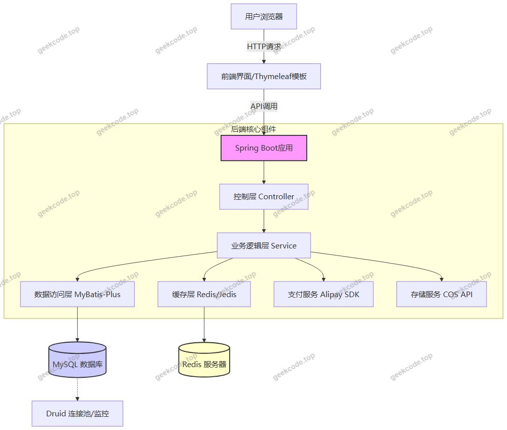
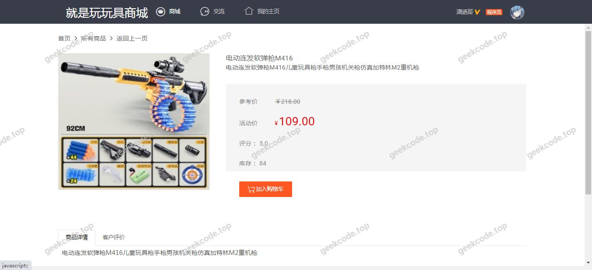
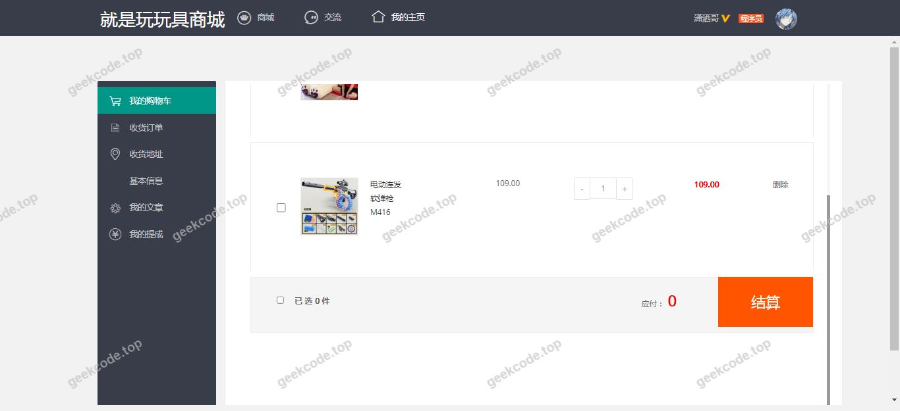
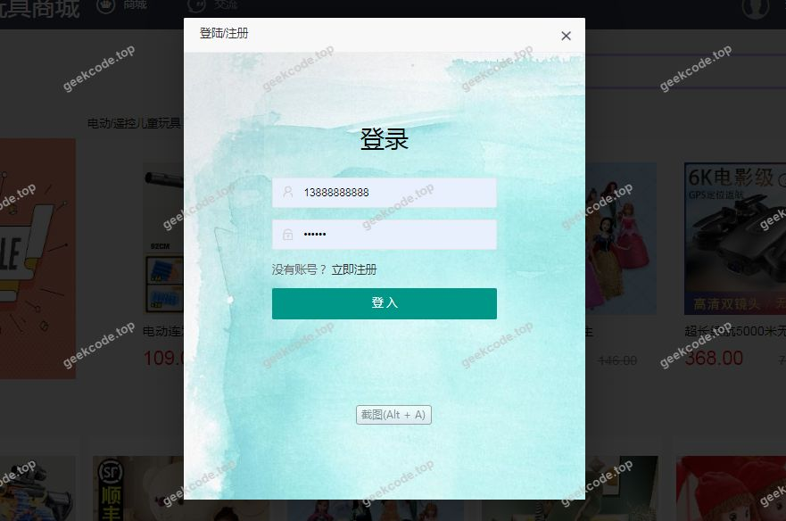
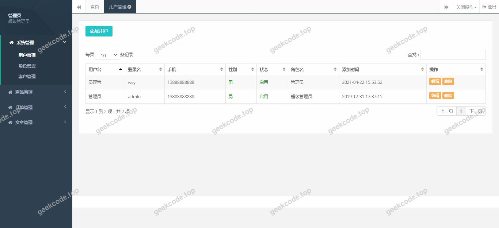
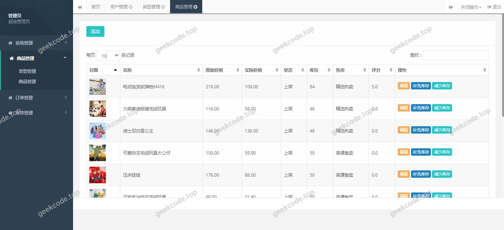
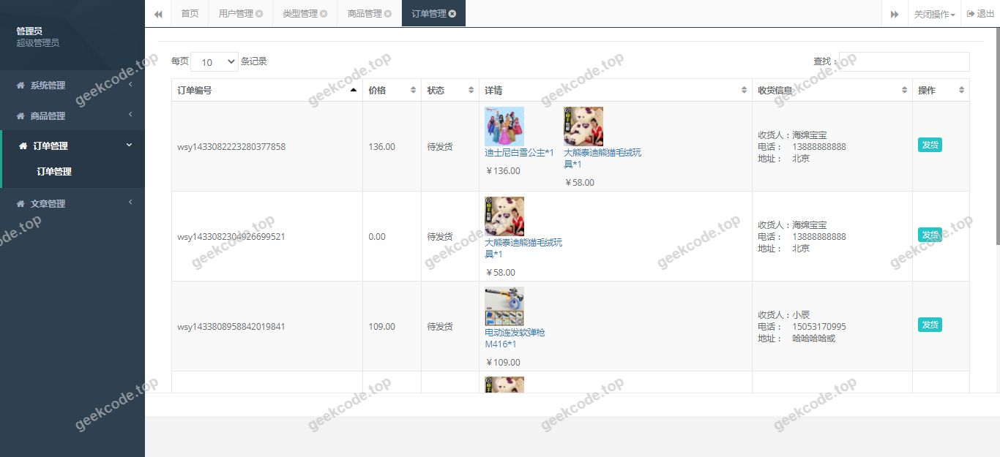

# java精品项目-基于ssm的玩具商城系统-25

> 🎓 **计算机毕业设计 · java精品项目-基于ssm的玩具商城系统-25**
>
> 本仓库只放**项目介绍 + 运行截图**（截图是站点带水印的原图，存在仓库 `images/` 里）。
>
> 👉 **完整可运行源码 / 数据库脚本 / 部署文档：[点我获取](https://geekcode.top/archives/java%E7%B2%BE%E5%93%81%E9%A1%B9%E7%9B%AE-%E5%9F%BA%E4%BA%8Essm%E7%9A%84%E7%8E%A9%E5%85%B7%E5%95%86%E5%9F%8E%E7%B3%BB%E7%BB%9F-25?utm_source=github)**
>
> 💬 咨询微信：**ir9372**　|　🌐 更多项目：[极客代码 geekcode.top](https://geekcode.top/?utm_source=github)
>
> 📌 项目详情页：<https://geekcode.top/archives/java%E7%B2%BE%E5%93%81%E9%A1%B9%E7%9B%AE-%E5%9F%BA%E4%BA%8Essm%E7%9A%84%E7%8E%A9%E5%85%B7%E5%95%86%E5%9F%8E%E7%B3%BB%E7%BB%9F-25?utm_source=github>

<table><td width="230" align="center"> <b>扫码加微信 ir9372</b></td><td valign="middle">📦 源码 = 项目介绍 + 全部运行截图 + 数据库 + 部署文档 👉 点上方任意截图，直接跳到 <b>极客代码 geekcode.top</b> 详情页</td></table>

---

<h1>java精品项目-基于ssm的玩具商城系统-25</h1>
<h2>项目概述</h2>

本项目名为“基于 SSM 的玩具商城系统”，旨在构建一个面向玩具零售场景的电子商务平台。尽管项目名称提及 SSM（Spring, Spring MVC, MyBatis），但根据实际代码依赖分析，底层架构已升级为更现代化的 <strong>Spring Boot</strong> 框架，并结合 <strong>MyBatis-Plus</strong> 进行数据持久层优化。系统核心目标是实现玩具商品的在线展示、交易管理及后台运营维护。适用人群包括玩具零售商、电商运营人员及最终消费者。技术架构上，采用前后端分离或混合渲染模式（视具体配置而定，此处依据 Thymeleaf 推测包含服务端模板渲染），利用 Redis 提升缓存性能，Druid 监控数据库连接池，并集成支付宝支付与腾讯云对象存储以支持完整的商业闭环。

<h2>技术架构</h2>

本系统采用分层架构设计，确保高内聚低耦合：

<ol>
<li><strong>后端服务层</strong>：</li>
</ol>
<ul>
<li><strong>核心框架</strong>：使用 <code>spring-boot-starter-web</code> 提供 RESTful API 及 Web 服务能力，<code>spring-boot-starter-aop</code> 用于处理日志、权限等横切关注点。</li>
<li><strong>ORM 框架</strong>：选用 <code>mybatis-plus</code> 及其 starter，简化 CRUD 操作，提高开发效率。</li>
<li><strong>数据库连接池</strong>：集成 <code>Druid</code>，提供高性能的连接池管理以及 SQL 监控统计功能。</li>
<li><strong>缓存机制</strong>：引入 <code>jedis</code> 客户端连接 <code>Redis</code>，用于热点数据（如商品详情、用户会话）的高速读取，减轻数据库压力。</li>
</ul>
<ol start="2">
<li><strong>前端/视图层</strong>：</li>
</ol>
<ul>
<li>虽然项目标记为 <code>html-static</code> 且无明确路由配置，但依赖中包含 <code>Thymeleaf</code>，表明系统可能采用服务端模板引擎渲染 HTML 页面，或通过静态资源托管配合 JS 动态加载数据。</li>
</ul>
<ol start="3">
<li><strong>第三方集成</strong>：</li>
</ol>
<ul>
<li><strong>支付模块</strong>：通过 <code>alipay-sdk-java</code> 集成支付宝支付接口，实现线上交易结算。</li>
<li><strong>文件存储</strong>：使用 <code>cos_api</code> 对接腾讯云对象存储（COS），用于商品图片等非结构化数据的云端存储与管理。</li>
<li><strong>工具类库</strong>：引入 <code>hutool-all</code> 提供通用的 Java 工具方法，<code>lombok</code> 简化实体类代码编写。</li>
</ul>
<ol start="4">
<li><strong>Mermaid 架构图</strong>：</li>
</ol>

<h2>功能模块</h2>

根据提供的截图列表（系统运行界面 1-7）及技术栈推断，系统主要包含以下功能模块。由于上下文未提供具体的菜单树和路由表，以下描述基于典型电商系统及现有依赖推导：

<h3>前台用户端（推测）</h3>

<em>注：上下文中明确标注“是否有前台：否”、“前台路由：无”，这与截图中的“front”标签存在矛盾。若严格遵循元数据“无前台”，则以下功能可能仅存在于测试阶段或作为纯后端接口存在。但鉴于截图显示“系统运行界面(front)”，通常指代用户可见界面。在此假设这些界面为用户交互入口。</em>

<ol>
<li><strong>首页展示</strong>：轮播图、推荐玩具、分类导航展示。</li>
<li><strong>商品浏览</strong>：按类别筛选、关键词搜索、商品详情页查看。</li>
<li><strong>购物车管理</strong>：添加商品、修改数量、删除商品、合计金额计算。</li>
<li><strong>订单结算</strong>：收货地址选择、支付方式选择（支付宝）、提交订单。</li>
<li><strong>个人中心</strong>：订单查询、历史购买记录查看。</li>
</ol>
<h3>后台管理端（推测）</h3>

<em>注：上下文中明确标注“是否有后台：否”、“后台路由：无”。同样，若无后台，则无法进行常规的商品上架和管理。若项目确实无任何管理界面，则所有数据需通过数据库直接初始化或 API 调用维护。以下模块基于“玩具商城系统”的完整生命周期需求列出，若实际部署中缺失对应UI，则视为功能未实现或仅保留后端接口。</em>

<ol>
<li><strong>商品管理</strong>：玩具信息的增删改查、库存调整、图片上传（至 COS）。</li>
<li><strong>订单管理</strong>：查看所有订单状态、发货处理、退款审核。</li>
<li><strong>用户管理</strong>：查看注册用户信息、禁用异常账号。</li>
<li><strong>数据统计</strong>：销售报表、流量分析（基于 Druid 和日志）。</li>
</ol>

<strong>重要说明</strong>：由于项目元数据明确标识“无前台”、“无后台”且无路由信息，上述功能模块的具体 UI 实现状态无法从源码配置中直接确认，仅能依据“玩具商城系统”的业务逻辑和依赖包（如支付、存储）推断其具备潜在的后端支撑能力。

<h2>用户角色与权限</h2>

根据现有项目配置信息，<strong>无法确定</strong>具体的用户角色划分及权限控制细节。

通常情况下，此类电商系统涉及的角色包括：

<ol>
<li><strong>普通用户（游客/会员）</strong>：拥有浏览商品、下单购买的权限。</li>
<li><strong>管理员</strong>：拥有商品管理、订单处理、用户管理的最高权限。</li>
</ol>

但由于上下文中未提供安全框架（如 Spring Security 或 Shiro）的配置，也未定义具体的角色枚举或权限注解，因此无法列出每个角色可访问的具体功能模块清单。系统可能处于未鉴权的开发阶段，或者权限控制逻辑未在提供的代码片段中体现。

<h2>项目特色与创新点</h2>
<ol>
<li><strong>现代化技术栈组合</strong>：摒弃了老旧的 XML 配置繁琐的 SSM 原生写法，全面拥抱 Spring Boot + MyBatis-Plus，显著提升了开发效率和代码可读性。</li>
<li><strong>高性能缓存策略</strong>：引入 Redis (Jedis) 作为二级缓存，针对玩具商城中高频访问的商品详情和首页数据进行加速，有效缓解 MySQL 数据库的压力，提升系统并发处理能力。</li>
<li><strong>云原生存储集成</strong>：通过 <code>cos_api</code> 将图片资源存储于腾讯云 COS，实现了应用服务器与文件存储的解耦，降低了本地磁盘 IO 瓶颈，便于系统的横向扩展。</li>
<li><strong>完善的支付生态</strong>：直接集成官方 <code>alipay-sdk-java</code>，确保了支付接口的安全性和稳定性，符合国内主流电商的交易习惯。</li>
<li><strong>健壮的数据监控</strong>：使用 Druid 作为数据源，不仅提供了高效的连接池管理，还内置了强大的 SQL 监控和防火墙功能，有助于及时发现慢查询和潜在的 SQL 注入风险。</li>
</ol>
<h2>部署环境</h2>

为了成功运行该 Spring Boot 玩具商城系统，需要准备以下软件环境：

<ol>
<li><strong>Java 开发环境</strong>：</li>
</ol>
<ul>
<li>JDK 版本：建议 JDK 8 或 JDK 11+（取决于 Spring Boot 具体版本，MyBatis-Plus 和 Hutool 对 JDK 8+ 兼容性良好）。</li>
</ul>
<ol start="2">
<li><strong>数据库服务</strong>：</li>
</ol>
<ul>
<li>MySQL：版本 5.7 或 8.0+，需创建相应的数据库实例并导入初始表结构。</li>
</ul>
<ol start="3">
<li><strong>缓存服务</strong>：</li>
</ol>
<ul>
<li>Redis：版本 5.0+，需启动 Redis Server 并确保端口（默认 6379）开放，供 Jedis 客户端连接。</li>
</ul>
<ol start="4">
<li><strong>构建工具</strong>：</li>
</ol>
<ul>
<li>Maven：用于依赖管理和项目打包（pom.xml 解析）。</li>
</ul>
<ol start="5">
<li><strong>云服务配置</strong>（可选，若启用相关功能）：</li>
</ol>
<ul>
<li>腾讯云账号：需开通 COS 对象存储服务，获取 SecretId 和 SecretKey 以配置 <code>cos_api</code>。</li>
<li>支付宝商户账号：需申请支付宝沙箱或正式环境应用，获取 AppID 和私钥以配置 <code>alipay-sdk-java</code>。</li>
</ul>
<ol start="6">
<li><strong>Web 服务器</strong>：</li>
</ol>
<ul>
<li>内置 Tomcat：Spring Boot Starter Web 已包含，无需额外安装外部 Tomcat。</li>
</ul>
<h2>五、技术特性</h2>
<ul>
<li>使用 MyBatis-Plus 简化数据访问层开发</li>
<li>使用 Redis 缓存提升系统性能</li>
</ul>
<h2>六、功能模块截图</h2>
<h3>前台用户端</h3>
<h4>系统运行界面1</h4>

<h4>系统运行界面2</h4>

<h4>系统运行界面3</h4>

<h4>系统运行界面4</h4>

<h4>系统运行界面5</h4>

<h4>系统运行界面6</h4>

<h4>系统运行界面7</h4>

---

## 获取完整源码

| 项目 | 说明 |
| --- | --- |
| 项目名 | java精品项目-基于ssm的玩具商城系统-25 |
| 运行截图 | 本文 8 张（站点带水印原图，仓库 `images/` 目录） |
| 完整源码 | [https://geekcode.top/archives/java%E7%B2%BE%E5%93%81%E9%A1%B9%E7%9B%AE-%E5%9F%BA%E4%BA%8Essm%E7%9A%84%E7%8E%A9%E5%85%B7%E5%95%86%E5%9F%8E%E7%B3%BB%E7%BB%9F-25?utm_source=github](https://geekcode.top/archives/java%E7%B2%BE%E5%93%81%E9%A1%B9%E7%9B%AE-%E5%9F%BA%E4%BA%8Essm%E7%9A%84%E7%8E%A9%E5%85%B7%E5%95%86%E5%9F%8E%E7%B3%BB%E7%BB%9F-25?utm_source=github) |
| 咨询微信 | **ir9372**（备注：jingpin-yuanma） |
| 更多项目 | [极客代码 geekcode.top](https://geekcode.top/?utm_source=github) |

> 需要源码、部署、改配置、跑不起来等问题，加微信 ir9372 沟通，说明项目名即可。
